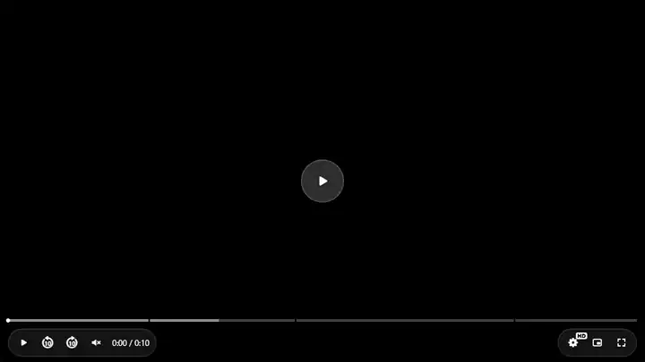

# HopeCorePlayer

[Türkçe](./README.tr.md)

[](https://github.com/umutyaldiz/hopecoreplayer/actions/workflows/ci.yml)
[](https://github.com/umutyaldiz/hopecoreplayer/actions/workflows/cross-browser.yml)
[](https://github.com/umutyaldiz/hopecoreplayer/actions/workflows/apple.yml)

[](https://www.npmjs.com/package/@hopeplayer/core)
[](https://www.npmjs.com/package/@hopeplayer/react)
[](https://www.npmjs.com/package/@hopeplayer/vue)
[](https://www.npmjs.com/package/@hopeplayer/react-native)
[](https://www.npmjs.com/package/@hopeplayer/core)
[](https://www.jsdelivr.com/package/npm/@hopeplayer/core)

[](./packages/core/src/types/index.ts)
[](https://github.com/video-dev/hls.js)
[](https://github.com/Dash-Industry-Forum/dash.js)
[](https://tailwindcss.com)
[](https://developer.mozilla.org/docs/Web/API/Web_components)
[](./packages/core/scripts/check-size.mjs)
[](./apps/playground/test/a11y.e2e.mjs)
[](./LICENSE)

**An open-source, monetization-first video player.** `<hope-player>` is a framework-agnostic Custom Element (Shadow DOM, TypeScript) with Google IMA, Prebid, rewarded ads, sponsorships, out-of-page ad triggers and Chromecast with TV ads built in — every feature is its own lazy-loaded chunk, so you only download what you configure. It works the same in plain HTML, React, Vue, Next.js and React Native.

<p align="center">
  <a href="https://www.umutyaldiz.com/hopecoreplayer"></a>
</p>

**Docs, live demos and the full options reference:** **[umutyaldiz.com/hopecoreplayer](https://umutyaldiz.com/hopecoreplayer)**

## Quick start — one line, no build step

```html
<script type="module" src="https://cdn.jsdelivr.net/npm/@hopeplayer/core@1/dist/hope-player.js"></script>

<hope-player src="https://test-streams.mux.dev/x36xhzz/x36xhzz.m3u8" style="display:block;aspect-ratio:16/9"></hope-player>
```

That's it: HLS, the quality menu, captions and keyboard shortcuts work out of the box. Configure everything else from JavaScript:

```html
<script type="module">
  const player = document.querySelector('hope-player');
  player.options = {
    src: '/video.m3u8',
    poster: '/poster.jpg',
    locale: 'en',
    ads: { adTagPreroll: 'https://pubads.g.doubleclick.net/gampad/ads?…' },
    cast: { chromecast: true, airplay: true },
  };
  player.addEventListener('hp:play', () => console.log('playing'));
</script>
```

> Use the full `…/dist/hope-player.js` path on CDNs — the player loads its plugins as relative chunks next to that file. unpkg (`https://unpkg.com/@hopeplayer/core@1/dist/hope-player.js`) and esm.sh work the same way.
>
> **In production, pin an exact version** (`@hopeplayer/core@1.6.0/dist/hope-player.js`): CDNs cache version ranges like `@1` for a while, so a new release can take time to show up, while an exact version URL never changes and is cached for good. Plugin chunks have content hashes in their names (`ads-DPL7m9PV.js`), so a new release never serves a stale chunk.

## Install with npm

```bash
npm install @hopeplayer/core                          # web component
npm install @hopeplayer/core @hopeplayer/react        # React / Next.js
npm install @hopeplayer/core @hopeplayer/vue          # Vue 3 / Nuxt
npx expo install @hopeplayer/react-native react-native-webview   # React Native
```

```js
import '@hopeplayer/core';
```

```jsx
import { HopePlayer } from '@hopeplayer/react';

<HopePlayer src="/video.m3u8" poster="/poster.jpg" cast={{ chromecast: true }} onPlay={() => {}} />;
```

See the [install guide](https://umutyaldiz.com/hopecoreplayer/install) for Vue, Next.js (SSR-safe) and React Native.

## Live demos

| | |
|---|---|
| Web Component | [Open in StackBlitz](https://stackblitz.com/edit/hopecoreplayer-vanilla?file=src/main.ts) · [`examples/vanilla`](./examples/vanilla) |
| React | [Open in StackBlitz](https://stackblitz.com/edit/hopecoreplayer-react?file=src/App.tsx) · [`examples/react`](./examples/react) |
| Vue | [Open in StackBlitz](https://stackblitz.com/edit/hopecoreplayer-vue?file=src/App.vue) · [`examples/vue`](./examples/vue) |
| React Native | [Open in Expo Snack](https://snack.expo.dev/@umutyaldiz/hopecoreplayer) · [`examples/react-native-expo`](./examples/react-native-expo) |

## Features

**Playback** — MP4 / WebM / HLS (hls.js, loaded only for HLS — a light build is optional; native on Safari / iOS) / DASH (dash.js, loaded only for DASH), DRM (Widevine, PlayReady, FairPlay), quality limits and data saver, live streams with a wall clock, fallback sources (`sourcePriority`), quality menu, alternate audio, WebVTT and in-stream captions, sprite thumbnails, chapters and markers, "most watched" heatmap, searchable transcript panel, skip intro / credits buttons, up-next card and end screen, polls / quizzes / shoppable product cards, playlist and story mode, audio player with vinyl mode, Picture-in-Picture (Document PiP with the player's own controls on Chrome / Edge), Chromecast and AirPlay.

**Measurement** — built-in QoE analytics and CMCD for CDN logs: startup time, rebuffer ratio, watch time, 25 / 50 / 75 / 100 %, quality switches and errors as `hp:analytics` events, batched to your endpoint (`sendBeacon`) and to GA4.

**Monetization**
- Google IMA: preroll / midroll / postroll, VMAP, overlay ads, retry and waterfall, OM SDK, SCTE-35 for live, Google DAI.
- Prebid video header bidding (direct VAST or GAM, with custom `cust_params`), consent (TCF / USP / GPP).
- Rewarded quality unlock, sponsorship layer from your own API, pause ads, rule-driven Ad Manager out-of-page ads (`adTriggers`).
- Casting keeps the ads: VAST / VMAP breaks are sent to the TV.

**Engineering**
- **Shadow DOM** — player styles never leak into the page, and the page never breaks the player.
- **Real code-splitting** — every plugin is a dynamic import; nothing you don't configure is downloaded or parsed.
- **Theming** — 4 presets plus CSS custom properties (`--hp-color-accent`…) and `::part()` hooks.
- **i18n** — every label and ad-UI string follows `locale` / `labels` (Turkish and English included).
- **One event API** — namespaced DOM `CustomEvent`s (`hp:ready`, `hp:adstart`, `hp:cast`…), from any framework.
- **Tested** — a Playwright end-to-end suite, an accessibility scan and a bundle-size budget (about 77 KB gzip on first load) run on every change in Chromium; Firefox and WebKit run nightly and before every release on Linux, and `npm run test:linux` reproduces that exact environment locally with Docker; real Safari (macOS) and Safari on the iOS Simulator run nightly on GitHub's macOS machines.

## Browser support

**Minimum:** Chrome / Edge 111+, Firefox 128+, Safari 16.4+ (macOS and iOS / iPadOS), Samsung Internet 22+ — the player's styles are built with Tailwind CSS v4, which [requires these versions](https://tailwindcss.com/docs/compatibility). Older browsers are not supported.

| Platform | Status |
|---|---|
| Chrome / Edge (desktop, Android) | ✅ Automated end-to-end tests on every change (Chromium), including mobile viewports |
| Firefox | ✅ Automated end-to-end tests nightly and before every release |
| Safari (macOS), iOS / iPadOS Safari | ✅ Supported — native HLS, iPhone video fullscreen and AirPlay paths are handled; automated WebKit tests nightly and before every release, plus nightly smoke tests in real Safari on macOS and in Safari on the iOS Simulator (playback, seeking, captions, native HLS, QR resume, audio mode); verified manually on iPhone |
| React Native (iOS / Android WebView) | ✅ Bridge covered by automated tests; WebView behaves like the platform browser |
| Chromecast / Google TV, Apple TV | ⚠️ Implemented against the official SDKs and covered by tests with simulated SDKs — not yet verified on real devices |
| Smart TV browsers (Tizen, webOS) | ❌ Not tested |

**How the cross-browser runs work:** the full end-to-end suite (15 suites — playback, ads, Cast, audio, accessibility, React Native bridge…) runs in Firefox and WebKit on GitHub Actions' Ubuntu 24.04 machines, which have no sound card. That is deliberately strict: it has caught real bugs that a desktop with speakers never shows, such as Firefox reporting a missing audio output as a fatal error, and WebKitGTK / WPE (Linux browsers, WPE-based TVs) losing seeks. Anyone can run the same environment locally with Docker — the official Playwright image, the same steps as CI:

```bash
npm run test:linux                  # Firefox + WebKit, all suites
npm run test:linux -- webkit cast   # one engine, chosen suites
```

Found a problem on a browser or device? Please [open an issue](https://github.com/umutyaldiz/hopecoreplayer/issues/new?template=bug_report.yml) with the browser and version.

**Accessibility:** controls are reachable and operable with the keyboard, have visible focus indicators and accessible names, and the player is scanned with axe-core (WCAG 2.1 A / AA) in CI — including menus, dialogs and overlays. With `accessibility: true` viewers also get an Accessibility menu: zoom (with keyboard and pinch), picture filters (black and white, daylight, night light, high contrast, red- / green- / blue-blind modes), mono audio, volume boost, large controls and a keyboard shortcut list (`?`).

## How it compares

| | HopeCorePlayer | video.js | Plyr | JW Player |
|---|---|---|---|---|
| License | MIT | Apache-2.0 | MIT | Commercial |
| Delivered as | Web component | JS library | JS library | JS library (hosted) |
| HLS | Built in (hls.js, lazy) | Built in (VHS) | Bring your own hls.js | Built in |
| DASH | Built in (dash.js, lazy) | Built in (VHS) | — | Built in |
| DRM (Widevine / PlayReady / FairPlay) | Built in | Plugin (`videojs-contrib-eme`) | — | Built in |
| QoE analytics | Built in (endpoint, GA4) | Third-party | — | Built in |
| Google IMA (VAST / VMAP) | Built in | Plugin (`videojs-ima`) | — | Built in |
| Prebid header bidding | Built in | Third-party plugins | — | Built in |
| Chromecast | Built in, with TV ads | Third-party plugin | — | Built in |
| Rewarded unlock / sponsorship / out-of-page triggers | Built in | — | — | — |
| React / Vue / React Native | Official wrappers | Community | Community | Official SDKs |

Based on each project's documentation as of November 2026 — corrections are welcome via an issue.

## Packages

| Package | Description |
|---|---|
| [`@hopeplayer/core`](./packages/core) | The `<hope-player>` custom element. |
| [`@hopeplayer/react`](./packages/react) | Thin React wrapper (prop/event bridge, SSR-safe for Next.js App Router). |
| [`@hopeplayer/vue`](./packages/vue) | Thin Vue 3 wrapper. |
| [`@hopeplayer/react-native`](./packages/react-native) | React Native wrapper — runs the player in a WebView with the same options and callbacks. |

All four are released together with the same version — see the [CHANGELOG](./CHANGELOG.md) and its versioning policy.

## Contributing

Bug reports, docs fixes and pull requests are welcome, in English or Turkish — see [CONTRIBUTING.md](./CONTRIBUTING.md). Please report security issues privately as described in [SECURITY.md](./SECURITY.md).

```bash
npm install
npx playwright install chromium
npm run build:core
npm run dev          # playground on http://localhost:5183
npm test             # full end-to-end suite (run with the playground up)
```

Repository layout: `packages/*` (core and wrappers), `apps/playground` (dev page and tests), `examples/*` (StackBlitz / Expo demos), `docs/` (architecture, plugin and theming notes). The documentation website is deployed separately and is not part of this repository.

## License

MIT © [Umut Yaldız](https://www.umutyaldiz.com)
